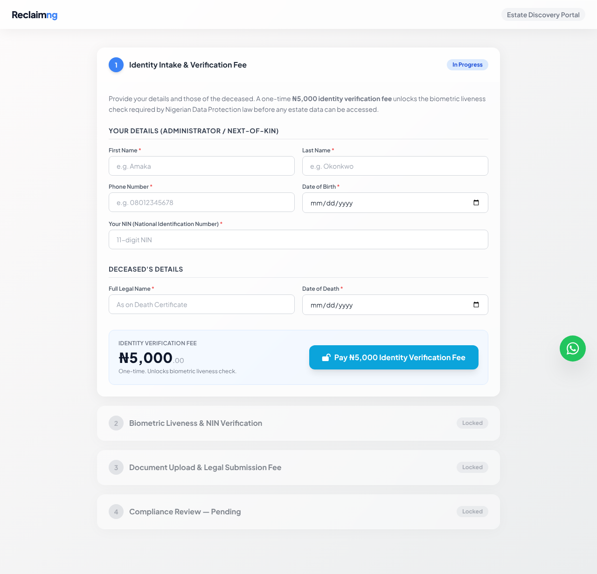
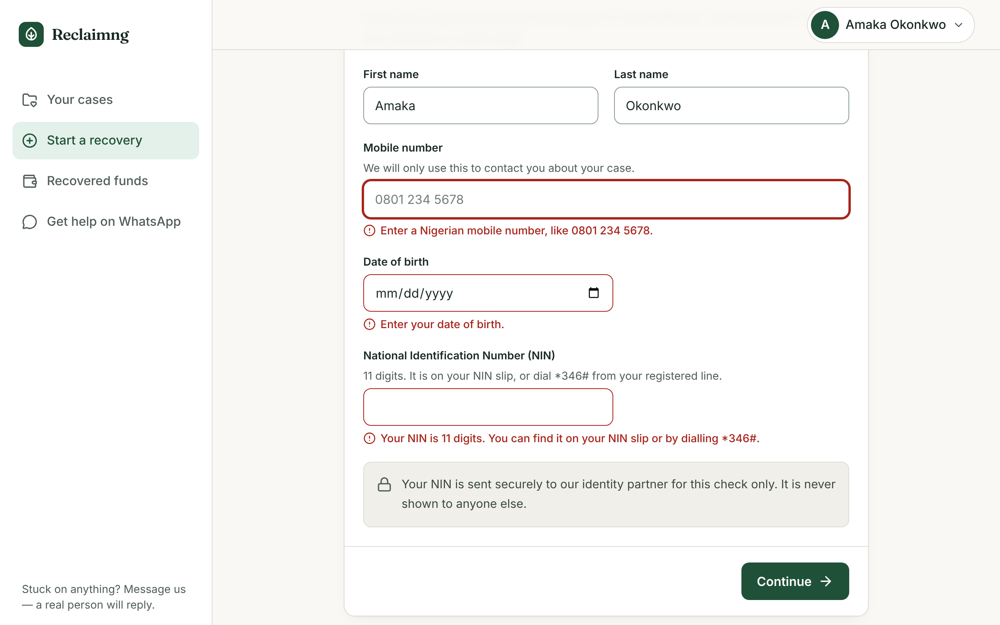
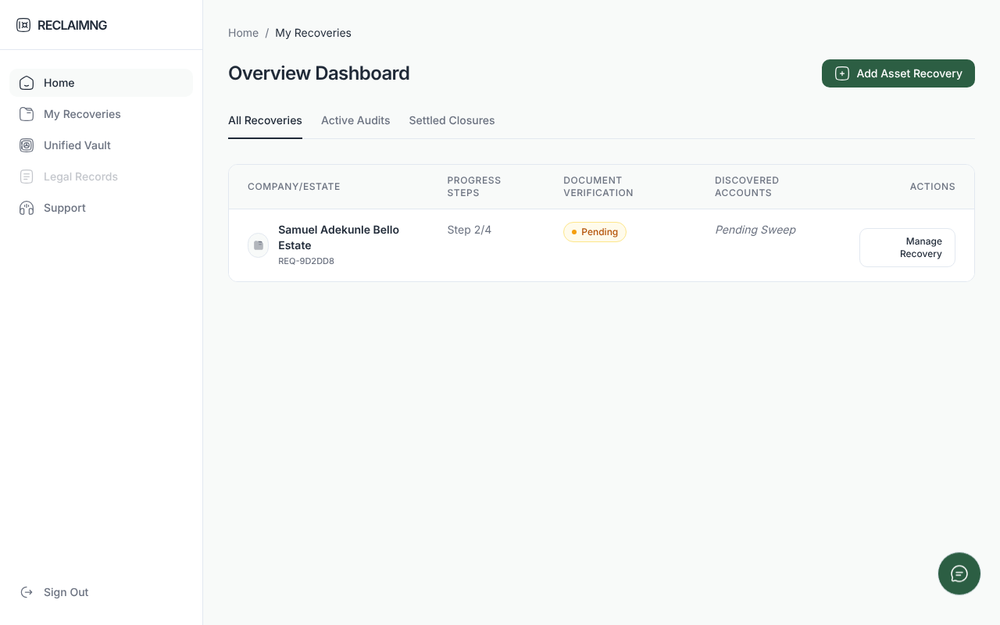
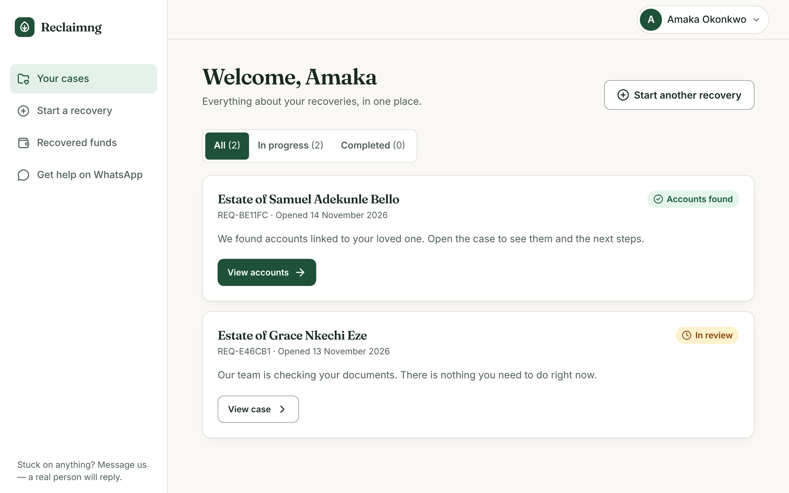
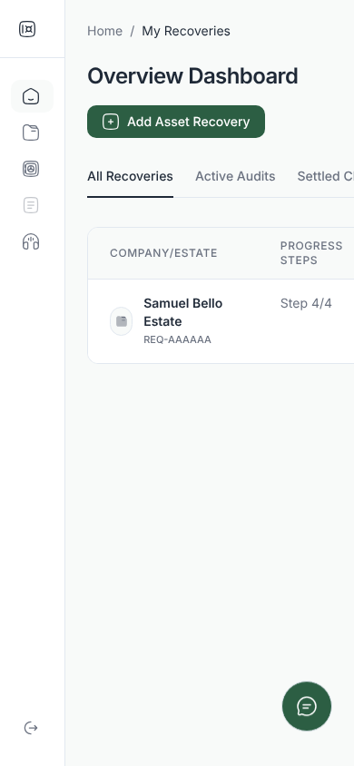
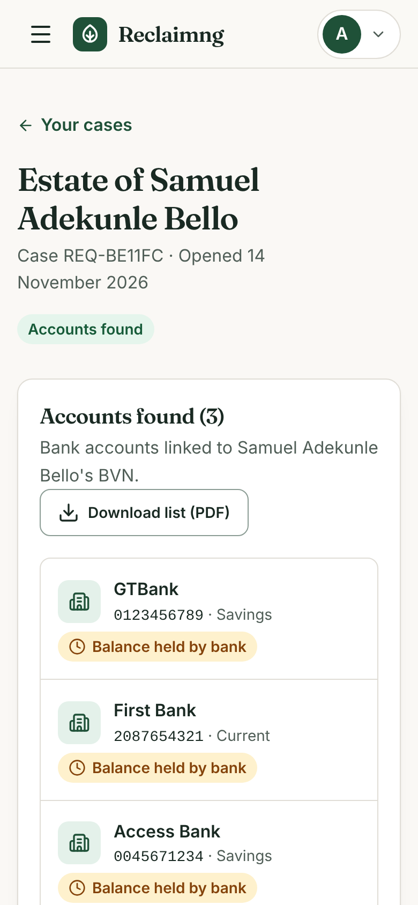

# Reclaimng: analysis, redesign and next steps

_November 2026. Covers the code on `main` at commit `d88002c` ("Update dashboard.html") and the redesign on branch `claude/happy-galileo-4uh7cb`._

## 1. Summary

**What the product is for.** A bereaved Nigerian family finds every bank account (and, per the PRD, every unclaimed dividend) a relative left behind, proves they are entitled to it, and gets the money paid into the estate. Reclaimng earns two set-up fees plus 10% of what is recovered.

**Where it stood.** The marketing page and the screens looked good, and the building blocks were well chosen: Supabase, Paystack, QoreID, Mono, Google Vision and pdf-lib. But when I ran every flow end to end, **the core journey could not be completed**, and several API routes could be used by anyone, without signing in, to change other people's data:

- The ₦75,000 document step fails for every user. Without Google Vision credentials it stops with an error. With them, it auto-rejects real death certificates, because it looks for the words "High Court" and "Probate", which appear on Letters of Administration, not on death certificates. Either way the family has already paid.
- The "biometric liveness" step was a 3-second timer that always passed with a hard-coded score of 99.1. No camera was ever used.
- BVN account discovery could not complete. The code read Mono's session id from the wrong place (Mono nests it under `data`), so the OTP step always failed with "Session ID and OTP are required".
- Downloading any PDF report failed. The report pages called the endpoint with GET while it only accepts POST, and the PDF builder crashed on the "₦" character anyway.
- The Unified Vault always errored. It queries `estates.total_asset_value`, a column no migration creates.
- Payment was trusted from the browser. A made-up Paystack reference was accepted as proof of the ₦75,000 fee.
- Anyone on the internet, signed in or not, could approve their own case past compliance and attach discovered bank accounts to it, flip other families' cases, generate "court" PDFs with invented assets, and verify NINs at the company's expense.

**What I did.** I rebuilt the front end as a single, accessible Next.js app with one design system. I rewrote every API route so it requires a signed-in user, checks ownership and verifies payments with Paystack on the server. I fixed each broken step above, and added **77 API tests, 56 browser-journey checks and an accessibility scan** that all pass. The tests run against local stand-ins for every provider, so no real money or identity data was involved.

**What still stands between this and the end goal** (section 7): nothing is wired in for dividends, which are half the PRD. Liveness is not integrated (the fake step is removed). There is no back office for the review team, no email or SMS notifications, and no mechanism to collect the 10% success fee. The biggest real-world blocker, getting Letters of Administration, sits outside the app. Section 8 lists the platforms that close each gap.

---

## 2. What exists today (before the redesign)

| Layer | What it was |
| --- | --- |
| Front end | 12 hand-written HTML pages in `public/` (Tailwind and Iconify from CDNs, inline scripts). Three pages repeated the Supabase anon key inline, and `latest.html` was a scratch file holding five pages concatenated together. |
| Auth | Supabase email/password and Google. `authGuard.js` checked a token in `localStorage` before rendering. |
| API | 10 Next.js route handlers in `app/api/` (listed in section 3). |
| Data | Supabase tables `verifications`, `estates` and `bvn_request_logs`, plus the private storage bucket `probate_documents` (4 SQL files). |
| Providers | QoreID (NIN), Mono Lookup (BVN to accounts, "iGree"), Paystack (fees and account-name lookups), Google Cloud Vision (OCR), pdf-lib. |
| Deployment | Vercel project `reclaiming`. Production currently runs with a **Paystack test key** (`/api/config` returns `pk_test_…`), so no real payments are possible yet. |

Pages named in the PRD that never existed: `wizard.html`, `admin-queue.html`, `admin-cms.html` and `dispute.html`. `latest.html` linked to all four, and every one returns 404.

**How I tested it.** I could not reach your live Supabase project: it is not in the Supabase account connected here, and reading the Vercel environment variables was blocked. So I built `tests/mock/upstreams.mjs`, a local stand-in for Supabase (auth, database with the schema and row-level security from your migrations, storage), Paystack, QoreID and Mono. Their responses are modelled on each provider's documented responses. I then drove the real code with HTTP calls and a real browser. Where a result depends on how your live database or keys are set up, I say so.

---

## 3. API endpoints: tested before and after

✅ works · ⚠️ works but unsafe or misleading · ❌ broken

| Endpoint | Before | After |
| --- | --- | --- |
| `GET /api/config` | ✅ Returns public keys only. | ✅ Unchanged. Now only a fallback, because pages read keys at build time. |
| `POST /api/verify-nin` | ⚠️ No sign-in needed. The `user_id` came from the request body, so anyone could store records against any user. Paid identity checks could be run for free, with no payment check. A cached result returned `EXACT_MATCH` even when the names sent were completely different. A mismatch returned QoreID's full raw record (address, photo, date of birth) to the caller. Because NIN was `UNIQUE`, a second account verifying the same NIN got a 200 and nothing saved. | ✅ Signed-in only. The user comes from the token. The ₦5,000 fee is verified with Paystack: amount, currency, payer and purpose. A payment cannot be reused. A failed name match keeps the payment for a retry. Errors name the field to fix but never echo the identity record. Photo and signature data are stripped before storage. A free pre-check runs before checkout (already verified? NIN already on another account?), so nobody pays for a check that can't succeed. |
| `POST /api/generate-qore-session` | ⚠️ Anyone could mint QoreID sessions. | ✅ Signed-in only. Not used by the UI yet (see section 7). |
| `POST /api/submit-documents` | ❌ With no GCP key: 503 **after** the files were stored and a case row created. With a key: real death certificates auto-rejected (keyword check). A made-up payment reference was accepted. `.exe` files were accepted. No sign-in; the owner came from the form. | ✅ Signed-in, identity-verified users only. Payment is verified **before** anything is stored. File type and size are enforced. Re-sending the same payment returns the same case, so a retry after a dropped connection is safe. OCR is now advisory only: it saves a note for the reviewer and never blocks or rejects. |
| `POST /api/update-milestone` | ⚠️ Anyone could change any case, even ones still in review. An unknown id still returned 200. | ✅ Owner only, and only once the case is approved. |
| `POST /api/igree/request-otp` | ❌ The session id was read from the wrong place in Mono's response, so the page showed "OTP sent to: undefined". No sign-in. Rate-limited per IP, which a fake `X-Forwarded-For` header bypasses. The full BVN was stored in logs. | ✅ Owner of an **approved** case only. Reads Mono's documented response shape and tells the user where the code was sent. Rate-limited per account. BVN masked in logs. |
| `POST /api/igree/verify-otp` | ❌ Always failed, a consequence of the above. Once working, it would let **anyone** set any case to `verified` (skipping compliance) and attach accounts to it. | ✅ Owner of an approved case only. Saves accounts in one consistent shape. **Never changes the compliance status.** |
| `POST /api/verify-estate-nuban` (payout gate) | ⚠️ Passed a relative who shares only the surname ("TUNDE BELLO" for Samuel Bello). Passed any company with "Estate" in its name ("REAL ESTATE VENTURES LTD"). The name to match came from the caller. | ✅ Requires an estate account (for example "Estate of Late …") **and** at least two of the deceased's names, taken from the case on file. All four bad cases are blocked. |
| `POST /api/generate-inventory` | ❌ Crashed on "₦" for every request. The UI called it with GET (405). Anyone could generate a "court" PDF with any names and amounts. More than about 20 assets were silently cut off. | ✅ Owner only, built from the case's own data. Multi-page. Labelled honestly as a working schedule, not a court order. |
| `POST /api/webhook/paystack` | ⚠️ The signature check was correct, but the checkout never sent metadata, so real payments matched nothing. A ₦1 charge with forged metadata marked a case paid. | ✅ Matches the case by its payment reference, requires the full fee amount and uses a constant-time signature comparison. |

All results: `npm run test:api` (77 tests). `npm run test:api:unmigrated` repeats them against the database as it is today, before migration `0005`; 76 pass and 1 needs the new ledger table.

---

## 4. User flows: tested before and after

| Flow | Before | After |
| --- | --- | --- |
| Visit the site | ✅ on Vercel | ✅ |
| Sign up / log in / log out | ✅ | ✅ Inline field errors, show-password, signed-in users skip the forms |
| Forgot password → emailed link | ❌ The link landed on the login form with no way to set a new password | ✅ `/reset-password` sets it; expired links explain what to do |
| Return from Google sign-in | ❌ `authGuard` ran before the token in the URL was read and bounced the user back to login | ✅ Signs in, including via the old `/dashboard.html` address |
| Refresh mid-wizard after paying ₦5,000 | ❌ Everything lost, user must pay again | ✅ Answers and step kept; a paid-but-unused payment is remembered so nobody is charged twice |
| Identity check | ❌ Fake liveness, always passes | ✅ Real NIN match; liveness to be added (section 7) |
| Send documents (₦75,000) | ❌ Fails after payment (above) | ✅ |
| Open "Manage recovery" straight after paying | ❌ Bounced back to the dashboard: payment status was never set to "paid" | ✅ Case page explains "in review, nothing to do now" |
| Bank letter PDF | ✅ but a blurry screenshot-PDF; the BVN, name and phone already collected were blank | ✅ Real text PDF, prefilled from the verified identity |
| BVN discovery | ❌ Fails at the OTP step; the page was open to signed-out visitors and hinted "use 123456" | ✅ Works end to end; signed-in owner of an approved case only |
| Schedule-of-assets PDF | ❌ | ✅ |
| Unified Vault | ❌ Database error on every load | ✅ "Recovered funds" with an empty state and totals |
| Dashboard filter tabs | ❌ All three tabs reloaded the same page | ✅ Filter for real |
| Phone-width layout | ❌ Dashboard and case page scrolled sideways by about 530px | ✅ No sideways scrolling on any page |

All results: `npm run test:flows` (56 checks in Chromium).

### Accessibility

Before, an axe-core scan found failures on 6 of 7 pages: low-contrast text, form fields without labels, icon-only links without names, and a constantly bouncing button (WCAG 2.2.2). Most tap targets were smaller than 40px. **After: zero violations on all 14 pages at both desktop and phone widths** (`npm run test:a11y`). Beyond the automated scan:

- All tap targets are at least 44px and body text is 16px.
- Each step starts with keyboard focus on its heading, and failed validation moves focus to the first problem.
- Errors are announced to screen readers and never rely on colour alone.
- There is a skip link, and the app honours reduced-motion settings.
- Date, phone and numeric inputs trigger the right phone keyboards.
- A NIN pasted with spaces is cleaned up rather than cut short.

---

## 5. The redesign

Patterns borrowed from Mobbin references:

- **Stripe** activation flow: one task per screen, steps named at the top.
- **WeTransfer** upload states.
- **Square**: plain-language "why we need this" notes next to sensitive fields.
- **Basecamp**: a calm, single-action interstitial.
- **incident.io**: a status timeline.

The visual language is warm paper, deep sage and a serif display face. It aims for "trustworthy family solicitor", not "crypto dashboard". All buttons, fields, alerts, dialogs, accordions, checkboxes and menus come from one kit in `components/ui/`: Radix primitives in the shadcn/ui style.

| Before | After |
| --- | --- |
|  |  |
|  |  |
|  |  |

The principles behind the changes:

1. **One answer to "what do I do now?"** The database keeps several separate flags: `status`, `mandate_acknowledged`, `discovered_accounts`. Families saw "Step 2/4", "Pending" and "Pending Sweep" side by side. `lib/estate.ts` now turns those flags into one stage. Each case card says who has the next move (you, or us) and offers a single button.
2. **Prices before payment, every time.** The fees are explained on the landing page, again before the wizard starts, and on each payment button ("Pay ₦5,000 and confirm"). Amounts come from one file, `lib/fees.ts`, which the server also checks. The 10% fee is stated in the consent text in plain words.
3. **Grief-aware copy.** "We are sorry for your loss. We will take this one step at a time." I removed system jargon ("Authenticate Protocol", "NIBSS network nodes", "Unified Sweep") and claims that weren't true:
   - "SEC & CBN Compliant", "NIBSS Integrated" and "All systems operational".
   - A sample ₦12,450,000 estate shown as if it were real.
   - A success page announcing "₦12,450,000 reclaimed".

   Under Nigeria's consumer-protection law, unsubstantiated claims like these are a risk.
4. **Never strand a paying family.** Every step after a payment can be retried without paying again. An automated check can advise the reviewer but can never reject a submission on its own.
5. **Help is always one tap away, in words.** "Chat with us" opens WhatsApp. Case pages pre-fill the message with the case reference.

Old addresses (`/dashboard.html`, `/auth.html?tab=signup`, `/recovery-detail.html?id=…` and so on) redirect to the new pages, so existing links keep working.

---

## 6. Before you deploy this branch

1. **Roll the Paystack test secret key.** Commit `d5bec29` (8 July) put a key beginning `psk_test_…` into the browser code of `discovery-wizard.html`. That looks like the test **secret** key with a stray "p" in front, and it differs from the public key used afterwards. It was replaced a commit later but stays in git history. Roll the test secret key in the Paystack dashboard to be safe, and never place `sk_` keys in front-end code (they now live only in server routes).
2. **Supabase → Authentication → URL configuration:** add `https://<your-domain>/app` and `https://<your-domain>/reset-password` to the redirect URLs. Without them, password reset and Google sign-in will not return to the right page.
3. **Run `supabase/migrations/0005_redesign.sql`** in the SQL editor. It adds:
   - the `settled` status and the columns the vault and case page use;
   - a payments ledger, so one payment can't be spent twice;
   - a unique payment reference per case;
   - masking of the raw BVNs already in `bvn_request_logs`.

   The app works without it but is safer with it.
4. **Paystack → Settings → Webhooks:** point it at `https://<your-domain>/api/webhook/paystack`.
5. **Switch to live keys.** Paystack is on test keys in production. Check that QoreID and Mono are on live credentials too.
6. Set the variables in `.env.example` in Vercel. `GCP_SERVICE_ACCOUNT_KEY_BASE64` is now optional.

---

## 7. Gaps between today and the end goal

Ranked by how much each one blocks a family from actually receiving money.

| # | Gap | Why it matters |
| --- | --- | --- |
| 1 | **Letters of Administration / Probate.** Every bank and registrar requires them before paying out. The app accepts cases without them (rightly) but offers no help getting them. | This is the single longest step for families: weeks to months, in each state's Probate Registry. Whoever helps with it owns the customer. |
| 2 | **Dividends are not covered at all.** The PRD's headline is "unclaimed dividends and frozen bank assets". The app only finds bank accounts, through the BVN. | Unclaimed dividends in Nigeria run into the hundreds of billions of naira. Without them, half the proposition is missing. |
| 3 | **No back office.** Reviewers have to edit rows in the Supabase dashboard to approve a case. There is no queue, no document viewer and no way to send a rejection reason (the UI can now display `review_note`, but nothing sets it). | It doesn't scale past a handful of cases and leaves no audit trail. |
| 4 | **No notifications.** The UI says "we will email you when the review is finished", but nothing sends email, SMS or WhatsApp yet. Your team must do it by hand until this is built. | The review can take up to 30 days; families will otherwise keep checking or messaging. |
| 5 | **No way to collect the 10% success fee.** Banks pay the estate account directly; nothing in the system invoices, collects or reconciles the fee. | It is the main revenue line. |
| 6 | **Liveness is not integrated.** The fake step is gone; NIN-plus-name matching remains. | Liveness stops someone using a stolen NIN slip. The API route to start a QoreID session already exists. |
| 7 | **BVN discovery depends on a bank changing the phone on a dead person's BVN.** That is a manual, branch-by-branch step with no guarantee banks will agree. | If banks decline, discovery stalls. |
| 8 | **Legal pages.** I kept your Privacy Policy and Terms word for word. Problems a lawyer should fix:  • They describe QoreID checking probate documents against "judicial archives"; QoreID checks the NIN, and documents are reviewed by people.  • They don't name Paystack, Mono, Google or Supabase as data processors, which the NDPA 2023 requires.  • They promise "AES-256 military-grade" storage.  • They describe automatic deduction of the 10% fee, which the system cannot do. | Regulatory exposure (NDPC) and consumer-protection exposure (FCCPC). |

---

## 8. Platforms and partners to integrate

Grouped by the gap they close. Before signing, confirm current availability, pricing and regulatory status directly with each provider; these markets change quickly.

### Finding more assets (closes gap 2, and widens the product)

| Asset | Who holds the records | How to integrate |
| --- | --- | --- |
| **Unclaimed dividends** | Share registrars (Meristem, Africa Prudential, First Registrars, Coronation Registrars, Cardinal Stone, United Securities and others) and the CSCS depository. | Start with a manual partnership: a standard "estate search" request to each registrar, which the back office tracks. Then ask the larger registrars and CSCS about API or bulk access. The SEC's **e-Dividend Mandate Management System (e-DMMS)**, run with NIBSS, is how beneficiaries mandate dividend payments to a bank account. Use it for the payout leg once shares are transmitted to the estate. |
| **Long-dormant money** | The **Unclaimed Funds Trust Fund** set up under the Finance Act 2020 (managed by the Debt Management Office), which receives long-unclaimed dividends and dormant balances. CBN has also issued rules on dormant accounts and unclaimed balances. | Add a "funds already transferred to government" search and claim path. Check the current thresholds and claim procedure with the DMO and CBN. |
| **Pension (RSA) balances** | Pension Fund Administrators, overseen by **PenCom**. A deceased worker's retirement savings account is paid to named beneficiaries or next of kin. | Often the largest single asset for salaried workers. Add an "employer / PFA" question and a claim pack per PFA. |
| **Group life insurance** | Insurers regulated by **NAICOM**. Employers must hold group life cover under the Pension Reform Act. | Ask for the employer; generate the claim letter. |
| **Deposits at failed banks** | **NDIC** (liquidation claims). | A simple lookup and claim guide for accounts at banks that have closed. |

### Probate (closes gap 1)

- **A panel of probate lawyers per state**, starting with Lagos, Abuja and Rivers. Families get a fixed-price "get my Letters of Administration" service, and Reclaimng takes a referral fee. Some state judiciaries have started online filing (check the Lagos State Judiciary's current e-filing). Wire in direct filing where it exists; elsewhere, send a lawyer a structured case pack built from what the family already uploaded.

### Identity and fraud (closes gap 6)

- **QoreID Web SDK** for liveness plus face-match against the NIN photo. QoreID documents a `qoreid-button` element with `clientId`, `productCode` (or `flowId`) and `customerReference`, plus submitted, error and closed callbacks. The existing `/api/generate-qore-session` route can feed it.
- Alternatives if QoreID's pricing or coverage doesn't fit: **Smile ID**, **Dojah**, **Prembly (Identitypass)** or **Youverify**. All cover NIN and liveness in Nigeria.

### Account discovery (closes gap 7)

- Keep **Mono Lookup** (BVN to linked accounts, with OTP consent). **Dojah**, **Prembly** and **Seamfix** offer similar iGree-based BVN lookups, which is useful as a fallback provider.
- Pursue a direct agreement with banks' **estate or probate desks**. A few Tier-1 banks handle deceased-customer claims centrally. A formal partnership, where the bank accepts Reclaimng's verified case pack, avoids the "change the phone number on the BVN" workaround entirely.

### Getting paid (closes gap 5)

- **Paystack** (already integrated) for the set-up fees. For the 10% fee, use **Paystack Payment Requests (invoices)** issued when a bank confirms a payout, or a **direct-debit mandate** set up at case opening, through Paystack's direct debit, **Mono DirectPay** or **Remita**, which many Nigerian banks support. Pair either with a signed fee agreement.
- **Paystack Transfers** or **Flutterwave** payouts, only if you ever hold client money. Holding client money brings licensing obligations; the current model, where banks pay the estate directly, avoids that.

### Keeping families informed (closes gap 4)

- **Email:** Resend, Postmark or Amazon SES. Trigger it from a Supabase database webhook when `estates.status` changes.
- **SMS:** **Termii** or **Africa's Talking**. Both are built for Nigerian delivery, including DND-safe routes.
- **WhatsApp Business Cloud API** (Meta): approved message templates for "your review is complete" and similar, and a shared inbox for the team instead of one personal number.
- **Support desk:** Intercom, Freshdesk, Zendesk or HubSpot, so every family conversation is tied to a case reference.

### Running the operation (closes gap 3)

- Build `/admin` inside this app (the PRD's `admin-queue`). It needs:
  - a review queue;
  - a side-by-side document viewer using Supabase signed URLs;
  - approve or reject with a `review_note`;
  - setting the `settled` status and amount.

  Restrict it with a Supabase custom claim for staff. The stage model in `lib/estate.ts` already drives the family-side screens.
- **E-signature** for the authority and fee agreement and the bank letters: Dropbox Sign or DocuSign, or Zoho Sign as a cheaper option.
- **Monitoring and analytics:** Sentry for errors; PostHog or Vercel Analytics to see where families drop out of the wizard.

---

## 9. Suggested order of work

1. Do the steps in section 6 (key rotation, auth redirect URLs, migration, live keys, webhook).
2. Build the back office and status notifications (gaps 3 and 4). Without them, the first real families wait in silence.
3. Add the success-fee agreement and collection (gap 5).
4. Run the probate lawyer panel pilot in Lagos (gap 1).
5. Add dividends through registrar partnerships, then pensions (gap 2).
6. Integrate liveness and fix the legal pages (gaps 6 and 8).
